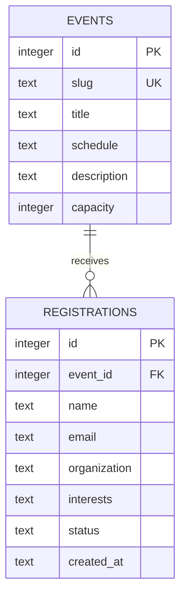

# Event Registration Platform

Public event discovery and registration, immediate available-place updates, private attendee search and admin check-in. React + Express + SQLite; source in `apps/events/`. Sample events and participants are fictional.

## Setup and admin

Node 24 LTS required. From the package root: `npm ci`, copy `.env.example` to `.env`, set ADMIN_USERNAME and ADMIN_PASSWORD (12+ characters), then `npm run db:init`, `npm run seed`, `npm run build`, `npm start`. Open `http://127.0.0.1:3100/#events`. Admin dashboard uses these configured credentials. Session cookies are HttpOnly and SameSite Strict, expire after two hours, and end on restart. Configure PORT and DB_PATH as needed. For only this assignment, set APP_MODULE=events or use export **codenova-event-registration**.

## Model and relationship diagram

`UNIQUE(event_id,email)` enforces one registration per normalized email per event. Emails are trimmed and lowercased. An immediate SQLite transaction locks the capacity check and insertion together, preventing concurrent overbooking. Interests are a validated JSON string; status is Confirmed or Checked in. `seed` inserts three events using unique slugs, so repeated runs are safe. Public event responses contain no participant details.

## API examples

| Endpoint                           | Behavior                                  |
| ---------------------------------- | ----------------------------------------- |
| GET /api/events                    | Events with capacity and available_places |
| POST /api/events/:id/registrations | Register; 201; duplicate/full → 409       |
| GET /api/admin/attendees?q=term    | Protected searchable attendee list        |
| PATCH /api/admin/attendees/:id     | Protected status change                   |

Registration: `{ "name": "Demo Student", "email": "demo@example.com", "organization": "Demo College", "interests": ["Design"] }`. Success: `{ "data": { "id": 1, "event_id": 1, "status": "Confirmed", "available_places": 29 } }`. Duplicate: HTTP 409 `{ "error": { "message": "This email is already registered for this event." } }`.

Interests: Web Development, Design, AI & Data, Mobile, Cybersecurity. Name/organization 1–120 characters; email ≤254; at least one supported interest required. Admin status body: `{ "status": "Checked in" }`. Login with POST `/api/admin/login` containing username/password, retain its cookie, then use protected routes. Unauthorized requests return 401. Invalid fields return 400; missing events/registrations return 404.

## Testing and demo

`npm run build` then `npm test`; focused `node --test tests/events.test.js`. Verifies success, normalized duplicate rejection, concurrent capacity, contact privacy, login/logout and protected check-in. See `docs/WALKTHROUGH.md` for both public and admin screens, and `docs/VERIFICATION.md` for execution evidence. Suggested repository: **codenova-event-registration**; main README includes upload commands.
